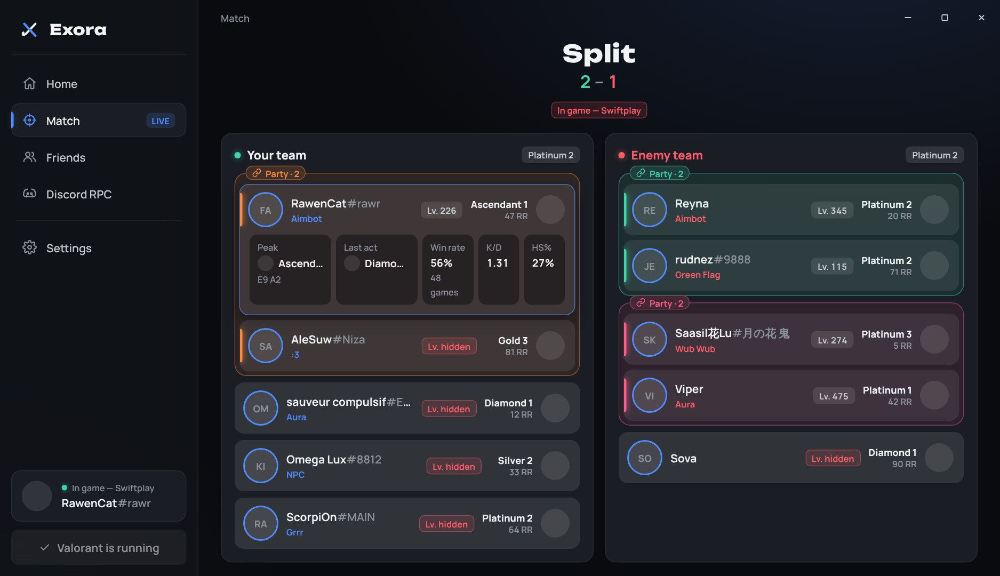
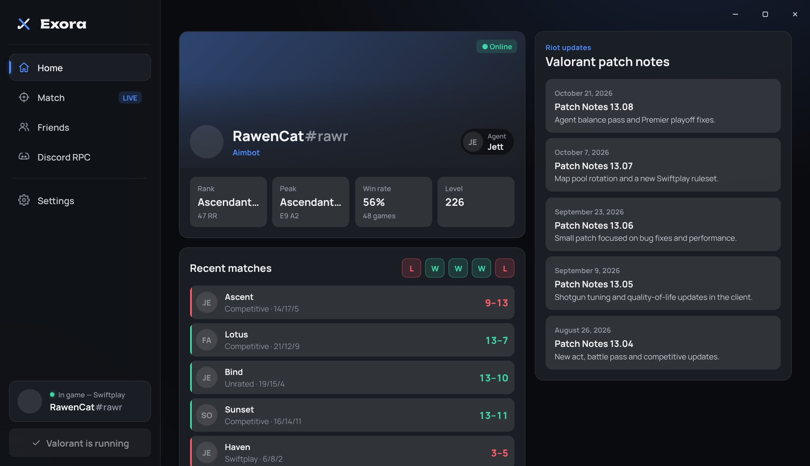
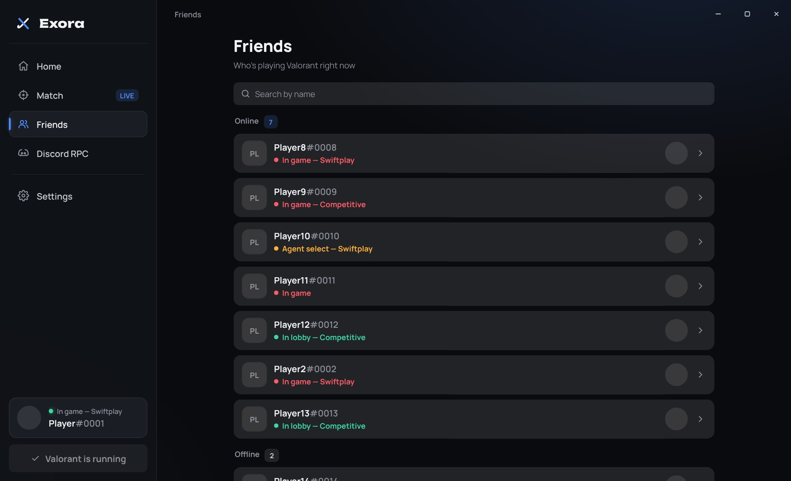
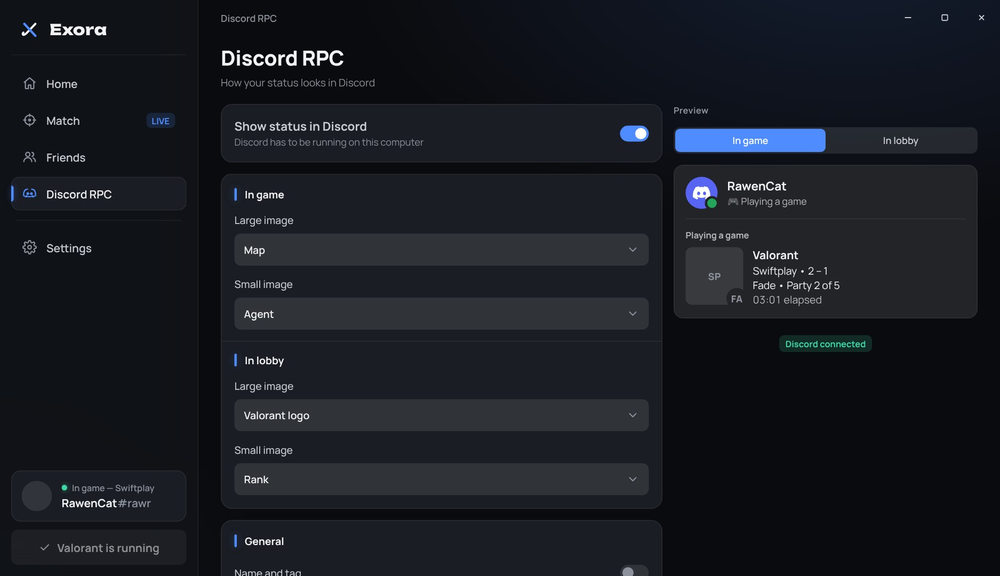
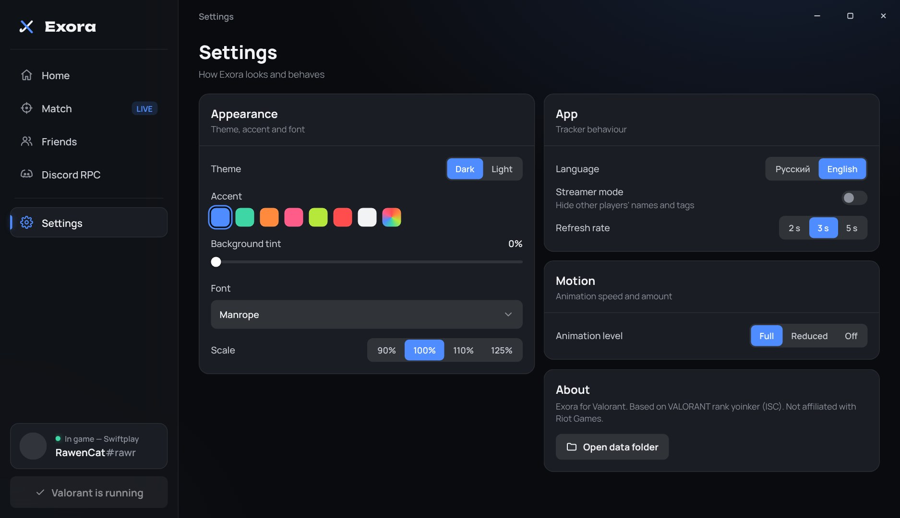

<div align="center">


# Exora for Valorant

**A beautiful tracker for Valorant**

Ranks, levels and stats of every player in your match, friends online and your own Discord status — in one exe.

`Windows 10 / 11` · `.NET 8 · WebView2` · `EN / RU`

**English** · [Русский](README.ru.md)

</div>

> **Based on VALORANT rank yoinker.** The Riot client logic is ported from
> [VALORANT rank yoinker](https://github.com/zayKenyon/VALORANT-rank-yoinker) (ISC license, see
> [THIRD-PARTY-NOTICES.md](THIRD-PARTY-NOTICES.md)). Exora is not endorsed by Riot Games.



---

## What it is

Exora is a desktop app that sits next to Valorant. It talks to the Riot client already running on your PC and shows
who you are playing with and against: rank, peak, level, win rate and parties. On top of that it sets a Discord
status you design yourself.

**The main rule: nothing hidden gets revealed and nothing touches the game.** Exora only reads what the Riot client
gives it. It doesn't read game memory or change game files, and players who hide their name or level stay hidden.

## Features

### ⚔ Match
When a match is found, Exora switches from Home to this page by itself.

- **Both teams** in agent select and in game: agent, name#tag, title, level, rank with RR or leaderboard place.
- **Parties:** players queued together are framed in one colour with a "Party · 2" label. Your own party and
  your friends' parties are exact. With **Detect parties from last matches** on, Exora also guesses other parties
  from each player's previous match and draws them with a dashed "Likely party" frame.
- **Click a player** to see their peak rank and act, last act rank, win rate, K/D and HS% from their latest
  competitive match.
- Average rank of each team; deathmatch shows a single list.

<p align="center">
  
  
</p>

### 🏠 Home
- Profile banner with your player card, title, rank and last agent.
- Rank, peak with act, win rate and level.
- Last 5 matches: win / loss, agent, map, mode, K/D/A and score (placement in deathmatch).
- **Open any of them** for the full scoreboard: rank, K/D/A, ACS, ADR and HS% of every player, exact parties.
  Click a player for first kills / deaths, KAST, spike plants and defuses, multi-kills, loadout, damage dealt
  and taken, head / body / leg hits and ability casts.
- While Valorant is closed, Home shows the last account you played on.
- Latest Valorant patch notes.

### 👥 Friends
- Who is in game, in agent select or in the lobby, with mode and rank.
- Ranks of offline friends; player cards are used as avatars.
- **Open a friend** to see their rank, peak, win rate and last matches, and open those matches from their side.
- Search by name.

### 🎮 Discord RPC
| Setting | Options |
|---|---|
| **In game** | large and small image: map / agent / rank / Valorant logo / player card / none |
| **In lobby** | the same set of images for the lobby |
| **Text** | name and tag, party size, match score, time in match |
| **Button** | your own text and link under the status |

The live preview shows exactly what Discord will show, for the game and for the lobby.

<p align="center">
  
  
</p>

### 🎨 Look
- Dark and light themes, 7 accent colours plus your own, background tint.
- Manrope / Onest / Unbounded / Segoe UI fonts, 90–125% scale.
- Smooth animations: full, reduced or off.
- The logo and the taskbar icon follow the accent colour.
- Streamer mode hides other players' names; Russian and English interface.

---

## How to run

### Ready build
1. Download `Exora.exe` from the latest **Build** run on the [Actions](../../actions) page (artifact **Exora**).
2. Run it. It's one self-contained file: no installation and no .NET needed.
3. If Windows says "Windows protected your PC", click **More info → Run anyway**.
4. Exora uses Microsoft Edge WebView2, which ships with Windows 10 / 11. If it's missing, Exora offers to download it.

### Discord status
Works out of the box: keep Discord running on the same PC and the status appears by itself.
Turn it off or change what it shows on the **Discord RPC** page.

### Building from source (Windows)
You need [Visual Studio](https://visualstudio.microsoft.com/) 2022 (17.8+) or 2026 with ".NET desktop development"
and [Git](https://git-scm.com/).

```sh
git clone https://github.com/rickrollru/ExoraValorant
```

1. Open `ExoraValorant.sln`.
2. At the top pick **Debug** and press <kbd>F5</kbd> to run.
3. For the final exe: right-click the project → **Publish** → the **Exe** profile → **Publish**.
   `Exora.exe` appears in the `publish` folder.

Or from a terminal:

```sh
dotnet publish src/ExoraValorant/ExoraValorant.csproj -c Release -o publish
```

---

## Settings and files

Everything is set up in the app. Files live in `%LOCALAPPDATA%\Exora`:

| File | What's inside |
|---|---|
| `settings.json` | all settings |
| `cache\` | names and icons from valorant-api.com (12 h), patch notes, friends' player cards |
| `exora.log` | log; attach it when reporting a bug |
| `webview\` | WebView2 browser data |

## For developers

| Where | What |
|---|---|
| `src/ExoraValorant/MainForm.cs` | borderless window, WebView2 host, messages to and from the page |
| `…/Riot/` | Riot client: lockfile, tokens, region, local and remote API, presence, game data |
| `…/Services/GameWatcher.cs` | polling loop: lobby / agent select / in game, match, friends, profile |
| `…/Services/PlayerStats.cs` | rank, peak, last act, win rate, K/D, HS% |
| `…/Discord/` | Discord Rich Presence |
| `…/wwwroot/` | the interface: HTML, CSS and JS without a build step, embedded into the exe |
| `…/wwwroot/js/mock.js` | demo data: open `index.html` in a browser to work on the UI without Valorant |
| `docs/logo/` | logo |

The web UI and the app exchange JSON messages; the data shapes are in `Services/UiState.cs`.

## Thanks and licenses

- [VALORANT rank yoinker](https://github.com/zayKenyon/VALORANT-rank-yoinker) — the Riot client logic, ISC license
  ([THIRD-PARTY-NOTICES.md](THIRD-PARTY-NOTICES.md)).
- [Valorant-API](https://valorant-api.com) — names and images of agents, maps, ranks and player cards.
- [DiscordRichPresence](https://github.com/Lachee/discord-rpc-csharp) — MIT;
  [Microsoft Edge WebView2](https://developer.microsoft.com/microsoft-edge/webview2/).
- Fonts [Manrope](https://fonts.google.com/specimen/Manrope), [Onest](https://fonts.google.com/specimen/Onest),
  [Unbounded](https://fonts.google.com/specimen/Unbounded) — SIL OFL.
- Exora is not endorsed by Riot Games and does not reflect the views or opinions of Riot Games or anyone officially
  involved in producing or managing Riot Games properties.

<div align="center">

Made by **Krutoy** · Discord: `rickroll.ru`

</div>
