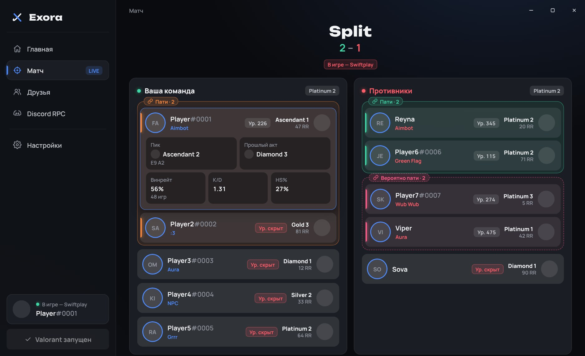
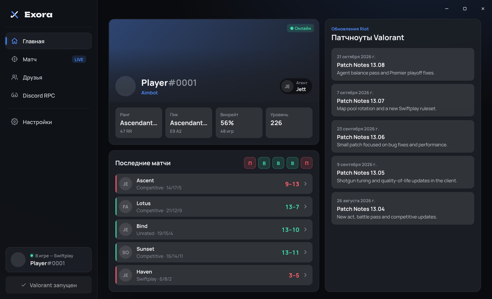
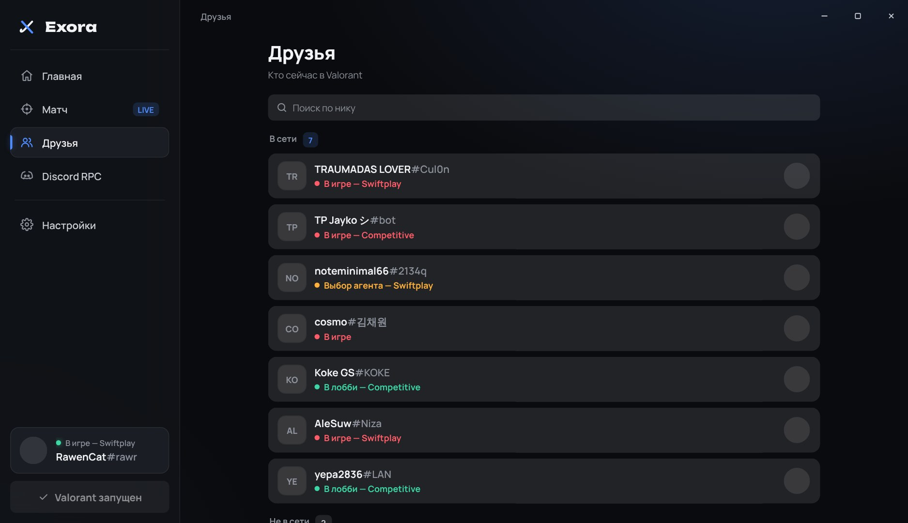
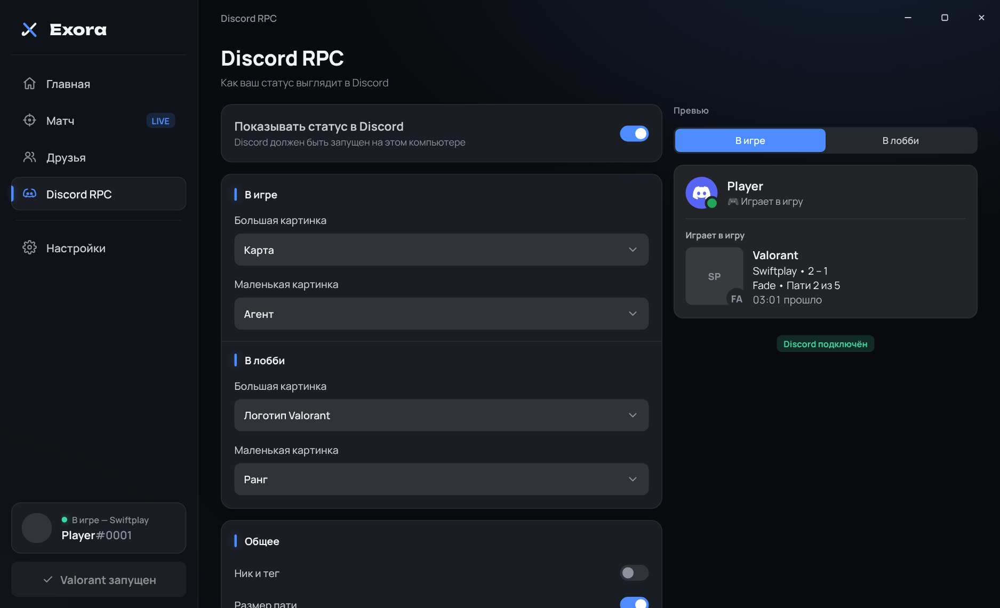
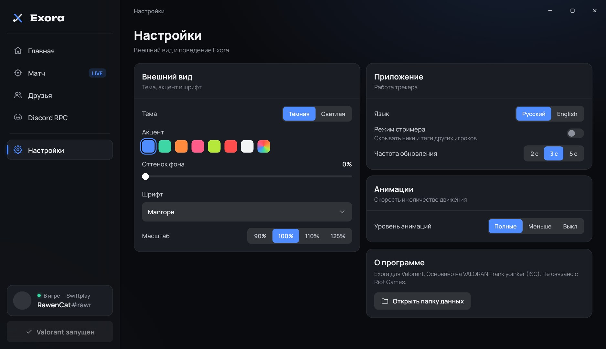

<div align="center">


# Exora для Valorant

**Красивый трекер для Valorant**

Ранги, уровни и статистика всех игроков в матче, друзья онлайн и свой статус в Discord — в одном exe.

`Windows 10 / 11` · `.NET 8 · WebView2` · `RU / EN`

[English](README.md) · **Русский**

</div>

> **Основано на VALORANT rank yoinker.** Работа с клиентом Riot перенесена из
> [VALORANT rank yoinker](https://github.com/zayKenyon/VALORANT-rank-yoinker) (лицензия ISC, см.
> [THIRD-PARTY-NOTICES.md](THIRD-PARTY-NOTICES.md)). Exora не связана с Riot Games и не одобрена ею.



---

## Что это

Exora — программа для компьютера, которая работает рядом с Valorant. Она подключается к уже запущенному клиенту Riot
и показывает, с кем и против кого ты играешь: ранг, пик, уровень, винрейт и пати. А ещё ставит в Discord статус,
который ты настраиваешь сам.

**Главное правило: ничего скрытого не раскрывается и игра не трогается.** Exora читает только то, что отдаёт клиент
Riot. Она не лезет в память игры, не меняет её файлы, а игроки со скрытым ником или уровнем остаются скрытыми.

## Возможности

### ⚔ Матч
Когда матч найден, Exora сама переключается на эту страницу с главной.

- **Обе команды** на выборе агента и в игре: агент, ник#тег, титул, уровень, ранг с RR или местом в таблице лидеров.
- **Пати:** игроки, которые зашли вместе, обведены рамкой одного цвета с подписью «Пати · 2». Твоя пати и пати
  друзей определяются точно. С галочкой **Определять пати по прошлым матчам** Exora угадывает и остальные пати
  по прошлому матчу каждого игрока и обводит их пунктиром с подписью «Вероятно пати».
- **Клик по игроку** показывает его пик и акт, ранг в прошлом акте, винрейт, K/D и HS% из последнего
  рейтингового матча.
- Средний ранг каждой команды; в бою насмерть — один общий список.

<p align="center">
  
  
</p>

### 🏠 Главная
- Баннер профиля с карточкой игрока, титулом, рангом и последним агентом.
- Ранг, пик с актом, винрейт и уровень.
- Последние 5 матчей: победа / поражение, агент, карта, режим, K/D/A и счёт (в бою насмерть — место).
- **Любой из них открывается** полной таблицей: ранг, K/D/A, ACS, ADR и HS% каждого игрока, точные пати.
  Клик по игроку — первые убийства / смерти, KAST, установки и обезвреживания спайка, мультикиллы, снаряжение,
  урон нанесённый и полученный, попадания в голову / тело / ноги и использование способностей.
- Пока Valorant закрыт, на главной показан последний аккаунт, на котором ты играл.
- Свежие патчноуты Valorant.

### 👥 Друзья
- Кто в игре, на выборе агента или в лобби, с режимом и рангом.
- Ранги друзей не в сети; карточки игроков используются как аватарки.
- **Профиль друга по клику:** ранг, пик, винрейт и последние матчи, которые открываются с его стороны.
- Поиск по нику.

### 🎮 Discord RPC
| Настройка | Варианты |
|---|---|
| **В игре** | большая и маленькая картинка: карта / агент / ранг / логотип Valorant / карточка игрока / нет |
| **В лобби** | тот же набор картинок для лобби |
| **Текст** | ник и тег, размер пати, счёт матча, время в матче |
| **Кнопка** | свой текст и ссылка под статусом |

Живое превью показывает ровно то, что увидят в Discord, и для игры, и для лобби.

<p align="center">
  
  
</p>

### 🎨 Оформление
- Тёмная и светлая тема, 7 цветов акцента и свой, оттенок фона.
- Шрифты Manrope / Onest / Unbounded / Segoe UI, масштаб 90–125%.
- Плавные анимации: полные, меньше или выключены.
- Логотип и иконка на панели задач перекрашиваются в цвет акцента.
- Режим стримера скрывает ники других игроков; интерфейс на русском и английском.

---

## Как запустить

### Готовая сборка
1. Скачай `Exora.exe` из последнего запуска **Build** на странице [Actions](../../actions) (артефакт **Exora**).
2. Запусти. Это один самодостаточный файл: ничего устанавливать не нужно, .NET тоже.
3. Если Windows пишет «Система Windows защитила ваш компьютер», нажми **Подробнее → Выполнить в любом случае**.
4. Exora использует Microsoft Edge WebView2, он уже есть в Windows 10 / 11. Если его нет, Exora предложит скачать.

### Статус в Discord
Работает сразу: держи Discord запущенным на том же компьютере, и статус появится сам.
Выключить его или поменять, что он показывает, можно на странице **Discord RPC**.

### Сборка из исходников (Windows)
Понадобятся: [Visual Studio](https://visualstudio.microsoft.com/) 2022 (17.8+) или 2026 с «Разработкой
классических приложений .NET» и [Git](https://git-scm.com/).

```sh
git clone https://github.com/rickrollru/ExoraValorant
```

1. Открой `ExoraValorant.sln`.
2. Вверху выбери **Debug** и нажми <kbd>F5</kbd>, чтобы запустить.
3. Чтобы собрать готовый exe: правой кнопкой по проекту → **Опубликовать** → профиль **Exe** → **Опубликовать**.
   `Exora.exe` появится в папке `publish`.

Или в терминале:

```sh
dotnet publish src/ExoraValorant/ExoraValorant.csproj -c Release -o publish
```

---

## Настройки и файлы

Всё настраивается в программе. Файлы лежат в `%LOCALAPPDATA%\Exora`:

| Файл | Что внутри |
|---|---|
| `settings.json` | все настройки |
| `cache\` | названия и иконки с valorant-api.com (12 ч), патчноуты, карточки друзей |
| `exora.log` | лог; прикладывай его, когда сообщаешь об ошибке |
| `webview\` | данные встроенного браузера WebView2 |

## Для разработчиков

| Где | Что |
|---|---|
| `src/ExoraValorant/MainForm.cs` | окно без рамки, WebView2, сообщения между программой и страницей |
| `…/Riot/` | клиент Riot: lockfile, токены, регион, локальный и удалённый API, presence, данные игры |
| `…/Services/GameWatcher.cs` | цикл опроса: лобби / выбор агента / игра, матч, друзья, профиль |
| `…/Services/PlayerStats.cs` | ранг, пик, прошлый акт, винрейт, K/D, HS% |
| `…/Discord/` | Discord Rich Presence |
| `…/wwwroot/` | интерфейс: HTML, CSS и JS без сборки, вшиты в exe |
| `…/wwwroot/js/mock.js` | демо-данные: открой `index.html` в браузере, чтобы делать интерфейс без Valorant |
| `docs/logo/` | логотип |

Интерфейс и программа обмениваются JSON-сообщениями; формы данных — в `Services/UiState.cs`.

## Спасибо и лицензии

- [VALORANT rank yoinker](https://github.com/zayKenyon/VALORANT-rank-yoinker) — работа с клиентом Riot, лицензия ISC
  ([THIRD-PARTY-NOTICES.md](THIRD-PARTY-NOTICES.md)).
- [Valorant-API](https://valorant-api.com) — названия и картинки агентов, карт, рангов и карточек игроков.
- [DiscordRichPresence](https://github.com/Lachee/discord-rpc-csharp) — MIT;
  [Microsoft Edge WebView2](https://developer.microsoft.com/microsoft-edge/webview2/).
- Шрифты [Manrope](https://fonts.google.com/specimen/Manrope), [Onest](https://fonts.google.com/specimen/Onest),
  [Unbounded](https://fonts.google.com/specimen/Unbounded) — SIL OFL.
- Exora не одобрена Riot Games и не отражает взгляды или мнения Riot Games или кого-либо, официально участвующего
  в создании или управлении проектами Riot Games.

<div align="center">

Сделано **Крутой** · Discord: `rickroll.ru`

</div>
